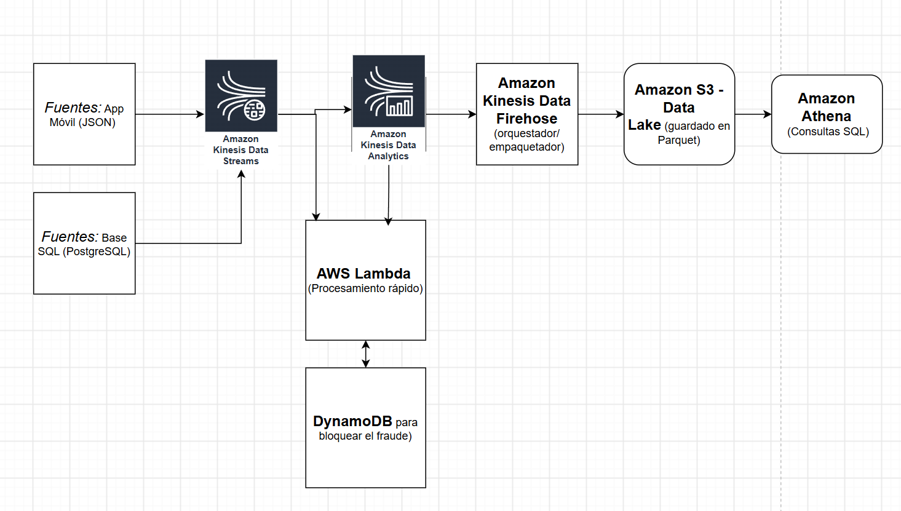

# Trabajo Práctico Final — Big Data y MLOps 2026

* **Estudiante:** Ricardo Matuk
* **Variante elegida:** Variante 1 — Investigación
* **Tema:** Sistema de Detección de Fraude en Tiempo Real para Fintech

---

## 1. Necesidad de negocio
* **Contexto:** La fintech "FinYa" ofrece tarjetas de débito virtuales y procesamiento de pagos en línea para comercios en Argentina..

 * **Usuarios y áreas involucradas:** El equipo de Prevención de Fraude, el área de Atención al Cliente (Soporte) y el equipo de Operaciones Legales.
 * **Problema actual:** El sistema actual está basado en reglas rígidas y batch (corre al final del día). Esto genera dos problemas graves: las transacciones fraudulentas se detectan horas después de que el dinero ya se transfirió (pérdida económica directa) y se bloquean cuentas legítimas por error (falsos positivos), frustrando a los usuarios legítimos.
* **Objetivo:** Diseñar una plataforma de datos capaz de ingerir, procesar y analizar transacciones financieras en tiempo real para bloquear operaciones fraudulentas antes de que se autoricen.
* **Beneficios esperados:** Reducción drástica del dinero perdido por fraudes, menor tiempo de respuesta ante ataques masivos y mejora en la retención de usuarios al reducir los bloqueos injustificados.
* **Evaluación del éxito (Métricas KPIs):**

  - Reducir el fraude financiero en un 40% en los primeros 6 meses.
  - Tiempo de procesamiento y scoring por transacción inferior a 150 milisegundos.
  - Tasa de falsos positivos por debajo del 1%.

---

## 2. Datos (Fuentes y Características)
* **Fuentes previstas (Disponibles):**

  - Base de datos transaccional relacional (PostgreSQL): Contiene el perfil del usuario, saldos, límites de crédito, tarjetas activas y el historial de cuentas bancarias asociadas.
  - Logs de la Aplicación Móvil/Web: Datos de inicio de sesión, direcciones IP, geolocalización del dispositivo, sistema operativo y tipo de red (Wi-Fi o datos móviles).

* **Fuentes previstas (Supuestos):**

  - Stream de Transacciones en tiempo real: Flujo continuo de datos que se genera cada vez que un usuario pasa la tarjeta o hace una transferencia (Monto, ID de comercio, Categoría del comercio, Timestamp exacto).
  -  Tipo y volumen estimado: Datos mixtos. Los transaccionales son estructurados (tablas SQL), mientras que los logs de navegación y geolocalización son semiestructurados (JSON). Se estima un volumen de 10 millones de transacciones diarias, lo que equivale a unos 50 GB de datos nuevos por día, incrementándose a 200 GB diarios al sumar los logs de clicks y navegación.
  -  Frecuencia de llegada: Streaming continuo las 24 horas, con picos de alta intensidad durante eventos comerciales (como el CyberMonday).

* **Calidad y sensibilidad:** Alta sensibilidad. Al tratarse de datos financieros y personales (DNI, números de tarjeta, ubicaciones), están sujetos a la Ley de Protección de Datos Personales (Ley 25.326). Los datos deben enmascararse o anonimizarse en las etapas de análisis general.
* **Restricciones:** No se pueden almacenar los códigos de seguridad (CVV) ni contraseñas bajo ninguna circunstancia, cumpliendo con las normas de seguridad PCI-DSS.

---

## 3. Arquitectura propuesta (Ecosistema AWS)
El recorrido de los datos está diseñado en capas para soportar tanto el análisis en tiempo real (Hot Path) como el almacenamiento masivo histórico (Cold Path):
* **Ingesta (Streaming y Batch):**

  - AWS Kinesis Data Streams: Recibe el flujo continuo de transacciones en tiempo real directamente desde las aplicaciones y la pasarela de pagos con latencia de milisegundos.
  - AWS Data Migration Service (DMS): Captura los cambios (CDC) de la base de datos relacional de usuarios (PostgreSQL) y los replica de forma asincrónica hacia el repositorio central.
 
* **Almacenamiento (Data Lake):**
        Amazon S3: Funciona como el Data Lake centralizado bajo el formato abierto Apache Iceberg o Delta Lake. Se organiza en tres zonas lógicas: Raw (datos crudos e inmutables), Trusted (datos limpios, validados y anonimizados) y Refined (agregados listos para consumo).
* **Procesamiento y Cómputo:** Amazon EMR (Elastic MapReduce) / AWS Glue: Utiliza Apache Spark para ejecutar las transformaciones pesadas en batch y el procesamiento de ventanas de tiempo en streaming para calcular variables sospechosas (ej: cantidad de transacciones de un usuario en los últimos 5 minutos).
* **Orquestación:** Amazon MWAA (Managed Workflows for Apache Airflow): Se encarga de programar, coordinar y monitorear las tareas diarias de limpieza, particionamiento de datos y consolidación de las tablas históricas.
* **Calidad y Gobierno de Datos:**
   - AWS Glue DataBrew / Great Expectations: Para aplicar reglas de calidad automáticas antes de pasar los datos a la zona Trusted.
   - AWS Lake Formation: Centraliza el gobierno de datos, gestionando los permisos y accesos a nivel de filas y columnas para proteger la información financiera sensible.

* **Visualización y Consumo:**
   - Amazon Athena: Motor de consultas SQL serverless para que los analistas de fraude investiguen patrones históricos directamente sobre S3.
   - Amazon QuickSight: Dashboard interactivo donde el equipo de Operaciones visualiza métricas de negocio, alertas de fraude activas y la tasa de falsos positivos en tiempo real.

---

##4. Modelado de datos
Para cumplir con la baja latencia en streaming y la capacidad de análisis histórico, se propone un modelo híbrido:

**A. Capa de Streaming (Consultas de tiempo real en Amazon DynamoDB)**

Se utiliza una estructura NoSQL orientada a documentos/clave-valor para almacenar los perfiles de comportamiento recientes (últimas 24 horas) y permitir que el motor de reglas consulte en milisegundos.
   - Colección / Tabla: Ultimos_Movimientos_Usuario
   - Clave de partición (Partition Key): id_usuario (Granularidad: Por usuario)
   - Clave de ordenación (Sort Key): timestamp
   - Atributos: monto_acumulado_1h, cantidad_transacciones_1h, ultima_provincia_detectada, lista_ultimos_dispositivos (Array).

**B. Capa Analítica e Histórica (Modelo Estrella en Amazon Redshift / Delta Lake)**

Para el análisis de patrones históricos y entrenamiento de modelos, los datos estructurados se organizan en un modelo de hechos y dimensiones con granularidad a nivel de transacción individual.

**Tabla de Hechos: Hechos_Transacciones**
   - Claves (FK): id_transaccion (PK), id_usuario, id_comercio, id_tiempo, id_dispositivo.
   - Métricas (Atributos cuantitativos): monto_transaccion, latitud, longitud, es_fraude (Booleano: 0 o 1).
**Tablas de Dimensiones:**
   - Dim_Usuarios: id_usuario (PK), nombre, fecha_alta, score_crediticio_inicial, provincia_residencia.
   - Dim_Comercios: id_comercio (PK), nombre_comercio, rubro_categoria, ciudad, riesgo_historico_comercio.
   - Dim_Dispositivos: id_dispositivo (PK), sistema_operativo, marca_modelo, huella_digital_dispositivo (device_fingerprint).
   - Dim_Tiempo: id_tiempo (PK), fecha_completa, hora, minuto, dia_semana, es_feriado.

**C. ¿Cómo responde este modelo a las preguntas de negocio?**

**1. ¿El usuario está transaccionando en dos lugares físicos distintos al mismo tiempo?**

Al cruzar la tabla de hechos actual con Ultimos_Movimientos_Usuario (DynamoDB), se calcula la velocidad de desplazamiento (distancia entre la ubicación de la última transacción y la nueva, dividido el tiempo transcurrido). Si es físicamente imposible viajar de una a otra, se dispara la alerta de fraude.

**2. ¿Este comercio está recibiendo ataques de tarjetas clonadas?**
Consultando la dimensión Dim_Comercios agrupada por la tabla de hechos en ventanas de 5 minutos, el negocio puede identificar si un comercio específico multiplicó sus transacciones rechazadas repentinamente.
**3. ¿Cuáles son los patrones de comportamiento de fraude según la hora o el rubro?**
Usando el modelo estrella en Redshift, el equipo de analítica puede correr consultas SQL pesadas para descubrir, por ejemplo, que el 80% del fraude ocurre de madrugada en el rubro "Criptomonedas" o "Videojuegos", permitiendo ajustar las reglas preventivas del negocio. 

---

##5. Justificación y limitaciones
Toda la arquitectura propuesta se fundamenta en la necesidad crítica de baja latencia para la prevención y alta capacidad de almacenamiento para la analítica masiva.

**Escala y Latencia:** La separación del flujo en dos caminos (Hot Path y Cold Path) mediante arquitectura Lambda/Kappa es indispensable. Amazon Kinesis Data Streams permite procesar ráfagas masivas de eventos en tiempo real con una latencia de milisegundos. AWS Lambda ejecuta las reglas de negocio de forma elástica, escalando a cero si no hay transacciones, lo que optimiza costos. Para la persistencia rápida, DynamoDB garantiza lecturas en un dígito de milisegundos para validar los perfiles de los usuarios en el momento exacto del pago.

**Costo y Almacenamiento (Cold Path):** Mantener petabytes de datos históricos en bases de datos relacionales o NoSQL tradicionales sería económicas y técnicamente inviable. El uso de Amazon S3 como Data Lake permite un almacenamiento desacoplado del cómputo a un costo ínfimo. El particionado de datos en S3 por año/mes/día y el formato columnar (Parquet) reducen drásticamente la cantidad de datos escaneados por Amazon Athena, minimizando el costo por consulta analítica.

**Seguridad y Operación:** Al delegar la infraestructura en servicios administrados (Serverless) de AWS, el equipo de ingeniería se desentiende del mantenimiento de servidores físicos, parches de seguridad y balanceadores de carga. La seguridad y gobernanza de los datos sensibles (regulados por la Ley 25.326 y PCI-DSS) se centralizan usando AWS IAM para políticas de acceso estricto y AWS KMS para el cifrado automático de datos tanto en tránsito como en reposo.

**Compromisos y Limitaciones (Trade-offs)**

**1. Consistencia eventual frente a disponibilidad:** Para lograr una latencia menor a 150ms, DynamoDB y las réplicas del flujo de streaming operan bajo el principio de consistencia eventual. Esto significa que si un usuario realiza dos transacciones en una ventana menor a un segundo, existe un riesgo mínimo de que la segunda transacción no tenga totalmente actualizado el balance analítico de la primera. Se asume este riesgo en pos de la velocidad del negocio.
**2. Dependencia del proveedor (Vendor Lock-in):** El uso extensivo de herramientas nativas de AWS (Kinesis, DynamoDB, Athena) acelera el tiempo de desarrollo y puesta en producción para llegar a la fecha límite, pero genera una dependencia absoluta del ecosistema de Amazon, dificultando una migración futura a otra nube (como Azure o Google Cloud) o a infraestructura local.

---

## 6. Diagrama de Arquitectura

